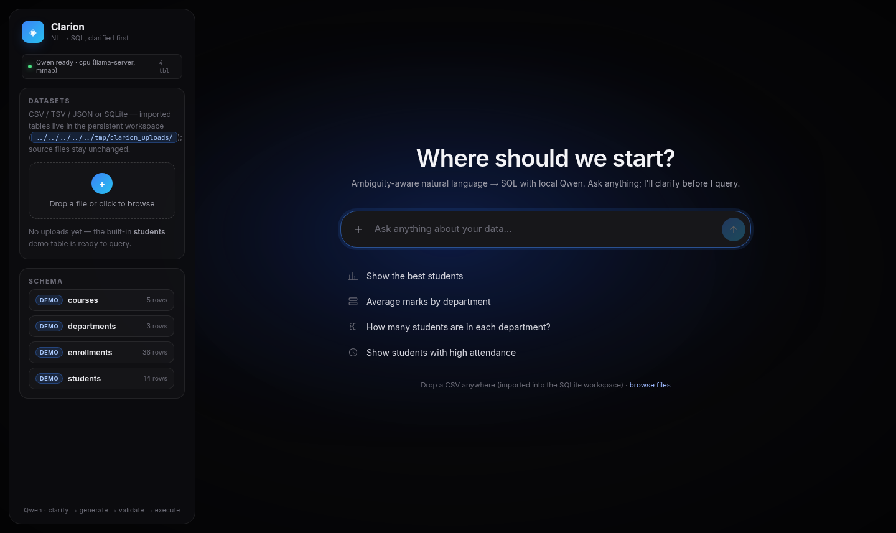
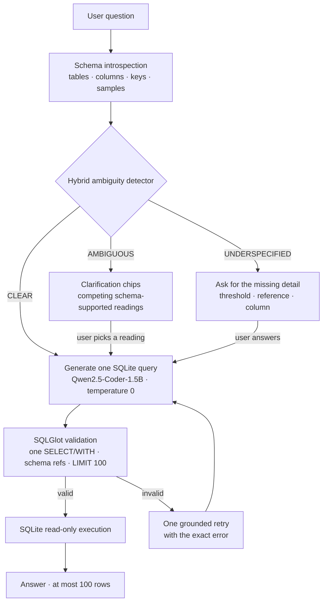
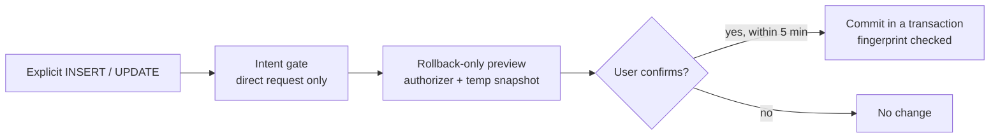
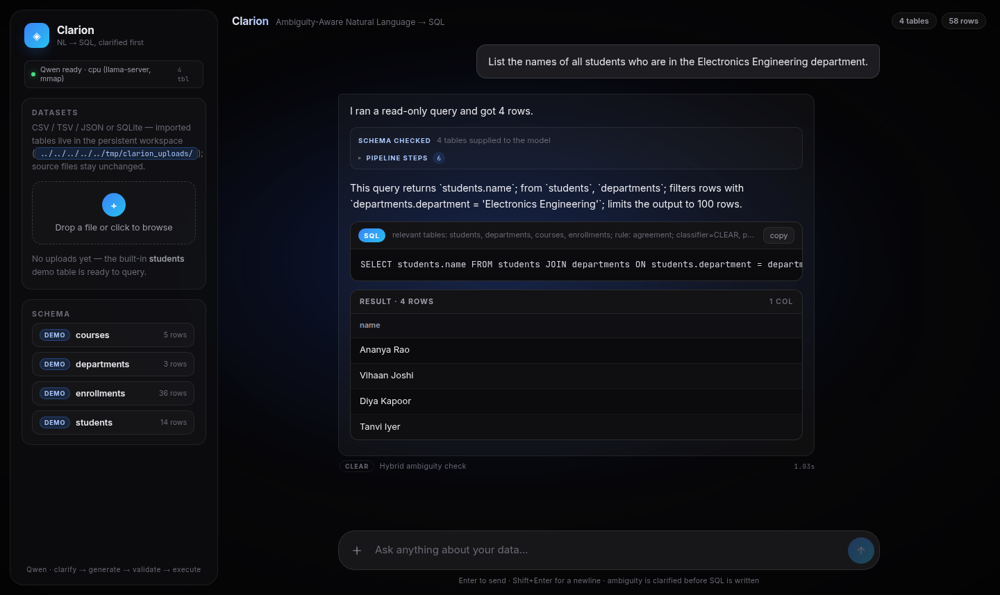

<div align="center">

# Clarion

**Ask your database in plain English. Clarify first, query second.**

Clarion is a local, ambiguity-aware **natural language → SQL** system. Before it writes a query, it checks whether your question has one defensible reading against the *actual* schema. If it does not, Clarion shows the competing interpretations and asks. Then a fine-tuned **Qwen2.5-Coder-1.5B** model writes one SQLite query, **SQLGlot** validates it, and **SQLite** runs it read-only.


[](report/screenshots/frontend.png)

<sub>Clarion's local chat UI — schema-aware, clarify-first, and fully inspectable.</sub>

</div>

---

## Contents

- [Why this exists](#why-this-exists)
- [How it works](#how-it-works)
- [What you get](#what-you-get)
- [Quick start](#quick-start)
- [First five minutes](#first-five-minutes)
- [Model setup](#model-setup)
- [Configuration](#configuration)
- [Run the pipeline without the UI](#run-the-pipeline-without-the-ui)
- [Architecture](#architecture)
- [Evaluation](#evaluation)
- [Tests](#tests)
- [Limitations](#limitations)
- [Troubleshooting](#troubleshooting)
- [Documentation](#documentation)

---

## Why this exists

A normal NL → SQL demo answers every question, even when the question is not answerable as written.

Ask **"Show the best students"** and the model has to invent an answer: best by marks? attendance? assignment score? Ask **"Show students with high attendance"** and a small model may invent a threshold — or an `attendance` column that does not exist. Ask about a column that does not exist and a small model may hallucinate a table that does.

Clarion treats **intent resolution** as a separate step from SQL generation:

- **CLEAR** — one defensible reading on this schema → generate SQL.
- **AMBIGUOUS** — two or more schema-supported readings → show interpretation chips and ask.
- **UNDERSPECIFIED** — a criterion, threshold, reference, or column is missing → ask instead of fabricating.

The result is a system that says "I need to know what you mean" before it says "here is your query."

## How it works



### 1. Read the real schema

`db_introspect.py` opens the database read-only and extracts tables, columns, declared types, primary and foreign keys, and a few sample values. It caches the result by file identity (path + mtime + size).

For each question, `build_schema()` selects up to six relevant tables by token overlap, renders a compact DDL block, adds verified join hints, and appends deterministic semantic hints from `semantic_ontology.py` — for example, "owe money" → `pending_fees`. Nothing is hardcoded to the demo database: upload a new SQLite file or CSV and the same path runs.

### 2. Decide whether the question is answerable

The ambiguity layer combines two independent signals:

| Signal | What it is | What it contributes |
| --- | --- | --- |
| **Classifier** | `all-MiniLM-L6-v2` embeddings of question-first + schema, plus handcrafted schema-context features, into a multinomial LogisticRegression | Fast, statistical 3-class label + probabilities |
| **SLM** | The same local Qwen model, prompted to return a structured verdict | Schema-aware reading of the question; returns label, reason, interpretations, and missing information |

The SLM's self-reported confidence is ignored — only its structural verdict is used. The classifier is question-first because MiniLM truncates at 256 tokens: a wide schema must not push the question itself out of view.

The two signals are combined by explicit rules (`agreement`, `conflict->clarify`, `slm-clear-overrides`, `classifier-below-threshold`, `fallback-heuristic`, ...). The decision includes the rule that fired and the raw evidence, so the UI can show *why* it asked. If the detector's artifacts or model call fail, the pipeline degrades to a rule baseline instead of crashing the request.

The classifier's artifacts live in `ambiguity/artifacts/` and are committed, so the detector works from a fresh clone without retraining. The first run downloads the `all-MiniLM-L6-v2` embedding model (~90 MB) from Hugging Face unless it is already cached.

### 3. Generate, validate, execute

Once the question is clear, Clarion asks the model for **exactly one** SQLite query using the same canonical system prompt used in training and evaluation. Temperature is 0; there is no creative SQL.

Every query passes through:

1. **SQLGlot parse** in SQLite dialect — exactly one `SELECT`/`WITH` tree; write, DDL, transaction, and multiple-statement payloads are rejected.
2. **Row cap** — a missing `LIMIT` is rewritten to `LIMIT 100`; results are fetched with `fetchmany(101)` and returned at most 100 rows.
3. **Schema-reference validation** — an AST walk checks that `FROM`/`JOIN` targets, aliases, CTE names, derived tables, and `table.column` qualifiers exist in the live database.
4. **Read-only execution** — `sqlite3.connect("file:...?mode=ro", uri=True)`, so even a validator miss cannot write.
5. **One grounded retry** — if validation or SQLite rejects the first attempt, the model gets the rejected SQL and the exact error once. If the retry fails, Clarion returns an error instead of a guess.

### 4. Writes are a separate, explicit path

Reads are the default. A write is considered only when the question is a direct `INSERT`/`UPDATE` request (`"add ..."`, `"update ..."`, `"set ..."`), never because the model guessed.



The write path is deliberately narrow:

- one statement, one target table;
- `UPDATE` needs a `WHERE` clause unless you explicitly said "all/every/each";
- the `WHERE` target must be grounded in your request (a literal or an ID from the question);
- the statement runs inside `BEGIN IMMEDIATE` with a temp snapshot and an SQLite authorizer that permits writes only to the target table;
- the preview is **rolled back**, so the database is byte-identical;
- the UI shows the SQL, affected rows, a before/after diff, duplicate-row and net-zero warnings;
- confirmation is required within five minutes, and a database fingerprint check refuses a stale preview;
- `DELETE`, DDL, `ATTACH`, `PRAGMA`, and multi-statement payloads are always rejected.

Writes change the workspace copy (`UI/uploads/clarion.db`), not the original file you uploaded.

### 5. One long-lived worker, one loaded model

The React UI talks to a Vite middleware API, which talks to a single long-lived Python worker over JSON-lines. The worker loads the model once at startup, streams pipeline progress to the browser, caches the detector result between the clarify and generate turns, and keeps per-tab session memory for typed clarification replies and referential follow-ups.

## What you get

| | |
| --- | --- |
| **Clarify before SQL** | Ambiguous questions become clickable interpretation chips, not silent guesses. |
| **Hybrid detector** | A statistical classifier and a schema-aware SLM cross-check each other. |
| **Schema-aware** | Table selection, join hints, and concept hints are derived from the live database. |
| **Local by default** | CPU inference through `llama.cpp`; no API keys, no cloud calls. |
| **Read-only first** | Every read is validated, schema-checked, row-capped, and executed on a read-only connection. |
| **Confirmed writes** | `INSERT`/`UPDATE` previews are rolled back until you explicitly confirm. |
| **Bring your own data** | Upload CSV, TSV, JSON, or SQLite; uploaded tables join the same pipeline. |
| **Inspectable** | See the detector label, rule, SQL, rows, pipeline steps, and latency for every turn. |
| **Session-aware** | Typed replies to clarify cards and follow-ups like "and their pending fees too" work. |
| **Multi-question** | Numbered compound questions are split and answered in one batch. |

## Quick start

> **Model weights are not in this repository.** GitHub is a poor place for a 941 MB checkpoint, so the GGUF and the `llama.cpp` build are gitignored. You need to provide a compatible checkpoint once — see [Model setup](#model-setup). Everything else is in the repo.

### 0. Prerequisites

- Python **3.12**
- Node.js **22.13+** (the workspace uses `node:sqlite`)
- CMake and a C/C++ toolchain (to build `llama.cpp`)
- A few GB of free disk for the model, build, and Python environment
- Linux or macOS; Windows works through WSL

### 1. Clone and install

```bash
git clone https://github.com/Halfgods/NLP-to-sql-ambiguity-detection.git
cd NLP-to-sql-ambiguity-detection

python3.12 -m venv .venv
source .venv/bin/activate

# CPU wheel first, so pip does not pull the CUDA build
pip install --index-url https://download.pytorch.org/whl/cpu torch
pip install -r requirements.txt
```

### 2. Build the inference server

```bash
git clone https://github.com/ggml-org/llama.cpp llama.cpp
cmake -S llama.cpp -B llama.cpp/build -DGGML_NATIVE=ON
cmake --build llama.cpp/build --config Release -j --target llama-server llama-quantize
```

Clarion starts `llama-server` itself; you do not need to run it in a separate terminal.

### 3. Provide the SQL checkpoint

Place a compatible GGUF at:

```text
models/qwen25-coder-1.5b-sql-write-q4_k_m.gguf
```

Or point the runtime at any compatible checkpoint:

```bash
export CLARION_GGUF=/absolute/path/to/your-model.gguf
```

The default is the project's Q4_K_M write-adapted checkpoint (~941 MB, CPU, ~1.06 GB RSS). The read-only baseline is `models/qwen25-coder-1.5b-sql-q4_k_m.gguf` if you have it.

If you do not have either checkpoint, use [Model setup](#model-setup) to build one.

### 4. Run

```bash
cd UI
npm install
npm run dev
```

Open **http://localhost:5173**.

On first start the workspace copies the demo tables from `data/people.db` and `data/academics.db` into `UI/uploads/clarion.db`. The sidebar shows `loading → ready` while the model warms up; the first question waits for it instead of reloading the model.

To produce a static bundle:

```bash
npm run build
npm run preview
```

`npm run preview` serves the same API middleware, so the pipeline still works.

## First five minutes

1. **Ask something clear** — `List the names of all students who are in the Electronics Engineering department.`  
   The detector returns `CLEAR`, the SQL card shows the query, and the result table shows the rows.
2. **Ask something ambiguous** — `Which department has the best students?`  
   Clarion returns interpretation chips such as *rank by average enrollment grade* or *rank by the highest individual grade*. Pick one; SQL is generated only after the choice.
3. **Inspect the schema** — `What tables do I have?`  
   Clarion answers from live introspection, without generating SQL.
4. **Upload your own data** — drop a CSV/TSV/JSON file in the sidebar. It becomes a real table in the workspace; ask about it the same way.
5. **Try a write** — `Add a student named Asha Rao to the Computer Engineering department.`  
   You get a rollback-only preview with the statement, affected rows, and a before/after diff. Nothing changes until you confirm.



## Model setup

Clarion runs a **Qwen2.5-Coder-1.5B-Instruct** model fine-tuned for SQLite. The runtime expects a GGUF checkpoint and a built `llama-server`.

### Use a checkpoint you already have

Any GGUF of the base model will run, but the project's accuracy numbers come from the write-adapted Q4_K_M checkpoint. Put it at the default path or set `CLARION_GGUF`.

### Rebuild the checkpoint

<details>
<summary><strong>Training pipeline (GPU, several hours)</strong></summary>

This is the path used to produce the evaluated checkpoints. It is not needed to run the app if you already have a compatible GGUF.

**Extra training dependencies** (not in `requirements.txt`):

```bash
pip install pandas pyarrow transformers peft accelerate bitsandbytes
```

**1. Prepare the SQL pairs**

`scripts/prepare_data.py` expects the source parquet files under `data/raw/` and the evaluation database `students.db` at the project root:

```text
data/raw/sql-create-context/**/*.parquet
data/raw/gretel/synthetic_text_to_sql_train.snappy.parquet
students.db
```

Then:

```bash
.venv/bin/python scripts/prepare_data.py
```

This writes `data/train_pairs.jsonl` (5,000 pairs), `data/eval_public.jsonl`, and `data/eval_domain.jsonl`.

**2. Train the read-only adapter**

Requires a CUDA GPU (4-bit NF4 QLoRA):

```bash
.venv/bin/python scripts/train_qlora.py \
  --data data/train_pairs.jsonl \
  --out adapters/qwen25c-1.5b-sql-lora
```

**3. Train the write adapter**

```bash
.venv/bin/python scripts/build_write_pairs.py
.venv/bin/python scripts/train_qlora.py \
  --data data/write_pairs.jsonl \
  --resume-adapter adapters/qwen25c-1.5b-sql-lora \
  --out adapters/qwen25c-1.5b-sql-write-lora \
  --epochs 8 --lr 1e-5
```

**4. Merge and quantize**

```bash
.venv/bin/python scripts/merge_lora.py \
  --adapter adapters/qwen25c-1.5b-sql-write-lora \
  --out models/merged-sql-write

scripts/build_write_gguf.sh
```

The result is `models/qwen25-coder-1.5b-sql-write-q4_k_m.gguf`. The read-only baseline is built by `scripts/build_gguf.sh`.

The training and runtime share `model_runtime.SQL_SYSTEM_PROMPT`, so the prompt used for evaluation is the prompt used in the app.

</details>

## Configuration

| Variable | Default | What it does |
| --- | --- | --- |
| `CLARION_GGUF` | `models/qwen25-coder-1.5b-sql-write-q4_k_m.gguf` | GGUF checkpoint served by `llama-server` |
| `SQL_MODEL_PORT` | `18766` | Port for the local model server |
| `CLARION_PYTHON` | `.venv/bin/python` | Python interpreter used by the UI worker |
| `CLARION_UPLOAD_DIR` | `UI/uploads` | Workspace directory for uploads and `clarion.db` |
| `CLARION_WORKSPACE_DB` | `UI/uploads/clarion.db` | SQLite workspace the pipeline queries |

Set them in the shell before `npm run dev`, or export them in your environment.

## Run the pipeline without the UI

The Python layer is usable on its own:

```python
from pipeline import analyze_question, answer_question

db = "UI/uploads/clarion.db"  # or any SQLite file

analysis = analyze_question("Which department has the best students?", db_path=db)
print(analysis.to_dict())
# {'decision': 'ambiguous', 'reason': ..., 'options': [...], 'decision_rule': ...}

result = answer_question(
    "List the names of all students who are in the Electronics Engineering department.",
    db_path=db,
)
print(result.sql)
print(result.columns)
print(result.rows)
```

Run the UI once to create the workspace, or pass `db_path="data/people.db"` to use the demo database directly. The UI workspace is needed only for uploaded tables and the combined demo schema.

You can also serve the model standalone:

```bash
scripts/serve_sql.sh
```

## Architecture

```text
.
├── UI/
│   ├── src/                  React app: chat, composer, sidebar, gradient backdrop
│   ├── server/
│   │   ├── api.js            Vite middleware API (upload, query, health, writes)
│   │   ├── model_bridge.js   One long-lived Python worker, JSON-lines protocol
│   │   ├── model_worker.py   Pipeline wrapper, session memory, write staging
│   │   ├── workspace.js      Seeds and manages UI/uploads/clarion.db
│   │   └── csv.js            Dependency-free CSV/TSV parser + type inference
│   └── vite.config.js        Dev server on 127.0.0.1:5173
├── ambiguity/
│   ├── analysis.py           Hybrid decision layer (classifier + SLM)
│   ├── classifier.py         MiniLM + LogisticRegression classifier
│   └── artifacts/            Committed classifier, thresholds, metadata
├── pipeline.py               Schema → detect → generate → validate → execute/write
├── db_introspect.py          Read-only schema extraction and table selection
├── semantic_ontology.py      Deterministic concept hints from column names
├── model_runtime.py          llama-server lifecycle + canonical SQL prompt
├── data/
│   ├── people.db             Demo students + departments
│   ├── academics.db          Demo courses + enrollments
│   └── ambiguity_train/      Ambiguity classifier training/eval splits
├── evals/                    Held-out classifier + SQL suite and reports
├── scripts/                  Data prep, QLoRA, GGUF build, evaluation, smoke tests
└── report/                   Architecture, figures, screenshots, report assets
```

### The pipeline in one sentence

`pipeline.answer_question()` builds the schema prompt, asks `llama-server` for one query, validates it with SQLGlot, checks every referenced table and column against the live database, executes it read-only, and retries once with the exact error if anything fails.

## Evaluation

The repository ships the evaluation suite and the latest report (`evals/REPORT.md`, `evals/report-latest.json`). The numbers below are from the committed report; they are not cherry-picked reruns.

### Ambiguity classifier

| Suite | Pairs | Accuracy | Macro-F1 |
| --- | ---: | ---: | ---: |
| Held-out, 6 schemas | 101 | **0.604** | **0.606** |
| Unseen-schema self-eval | 240 | **0.650** | **0.645** |

On the held-out set, `AMBIGUOUS` precision is **0.842** and recall is **0.471**. The low recall is the honest weak spot: the classifier misses some ambiguous questions, which is exactly why the SLM cross-check and the clarification flow exist.

### SQL generation

| Metric | Result |
| --- | ---: |
| Pairs evaluated | 101 / 101 |
| SQL produced | 1.000 |
| Valid read-only SQL | 1.000 |
| Executed | 0.960 |
| Normalized execution accuracy | **0.7822** |
| Strict execution accuracy (4 dp) | **0.6733** |
| Mean latency (CPU) | **1.55 s** |
| p95 latency (CPU) | **2.81 s** |

Per category (normalized execution accuracy):

| Category | n | Accuracy |
| --- | ---: | ---: |
| Aggregate | 17 | 1.000 |
| Arithmetic | 2 | 1.000 |
| Filter | 15 | 0.867 |
| Date | 6 | 0.833 |
| Group / having | 16 | 0.750 |
| Order / limit | 16 | 0.688 |
| Join | 22 | 0.682 |
| Nested | 7 | 0.571 |

### Rerun it

```bash
# Classifier suite only — works from a fresh clone
.venv/bin/python scripts/eval_full.py --suites classifier

# Full suite — needs students.db at the project root
.venv/bin/python scripts/eval_full.py
```

The full suite starts the model server automatically and writes `evals/REPORT.md` and `evals/report-latest.json`. Missing artifacts are reported as `NOT RUN (<reason>)`, not silently skipped.

## Tests

```bash
pip install pytest

# Python: ambiguity layer, SQL validation, schema cache, session memory, writes
.venv/bin/python -m pytest

# Node: workspace WAL + upload import
node --test tests/test_workspace_wal.mjs
```

Additional smoke checks:

```bash
.venv/bin/python scripts/smoke_write_path.py
node scripts/smoke_upload_import.mjs
```

## Limitations

Clarion is a research prototype, not an autonomous database agent.

- **The model is small.** 1.5B parameters on CPU is fast enough for interactive use, but joins, nested queries, and date arithmetic are still the weak categories (see the table above).
- **The classifier is not perfect.** Held-out `AMBIGUOUS` recall is 0.47. The hybrid layer and the clarify-first UI reduce the damage, but they do not eliminate it.
- **The SLM can over-read a schema.** On an unfamiliar database it may claim that a missing column is supported. The ambiguity layer's metric check and the read-only validation catch some of these cases, but not all of them.
- **The demo schema is small.** The built-in workspace has `students`, `departments`, `courses`, and `enrollments` — grades and fees, not marks or attendance. Upload a CSV/SQLite with those columns, or point the pipeline at a database that has them, to try those questions.
- **Training data is synthetic.** The ambiguity dataset is template-generated across seven schema families; real schemas will shift the distribution. The unseen-schema self-eval is the honest estimate, not the training accuracy.
- **SQLite only.** The validator, dialect, and write path are SQLite-specific. PostgreSQL/MySQL syntax is out of scope.
- **Writes are deliberately narrow.** One `INSERT` or `UPDATE` per turn; no `DELETE`, DDL, bulk import, or multi-statement transactions. The preview is a safety check, not a backup.
- **No authentication.** The Vite server binds to `127.0.0.1`. Do not expose it to a network without adding access control.
- **Model weights are not in the repo.** A fresh clone needs a checkpoint or a rebuild.

## Troubleshooting

| Symptom | Fix |
| --- | --- |
| `quantized model not found` | Put the GGUF at `models/qwen25-coder-1.5b-sql-write-q4_k_m.gguf` or set `CLARION_GGUF`. |
| `llama-server not built` | Build `llama.cpp` with the commands in [Quick start](#quick-start). |
| Sidebar stuck on `loading` | Check the terminal running `npm run dev` for the worker's stderr; the model may still be loading, or Python dependencies may be missing. |
| `node:sqlite` is not available | Upgrade Node.js to **22.13+**. |
| `database is locked` | Close other processes using `UI/uploads/clarion.db`; the workspace uses WAL and a busy timeout, but an external writer can still block it. |
| Port `18766` is already in use | Set `SQL_MODEL_PORT=18767` (or another free port) before `npm run dev`. |
| SQL suite says `NOT RUN` | The full SQL suite needs `students.db` at the project root; the classifier suite does not. |
| The model answers a different question | That is the failure mode this project targets. Rephrase with the metric or column you mean, or use the clarification chips. |

## Documentation

| Document | What is inside |
| --- | --- |
| `ambiguity/SELF_EVAL.md` | Classifier self-evaluation, confusions, limitations |
| `evals/REPORT.md` | Latest held-out classifier + SQL report |
| `evals/README.md` | Evaluation contract, label definitions, gold-set provenance |
| `models/README.md` | Checkpoint layout and build notes |
| `report/README.txt` | Report assets and rebuild instructions |

---

<div align="center">
<sub>Built with Qwen2.5-Coder-1.5B, llama.cpp, SQLGlot, sentence-transformers, React, and SQLite.</sub>
</div>
